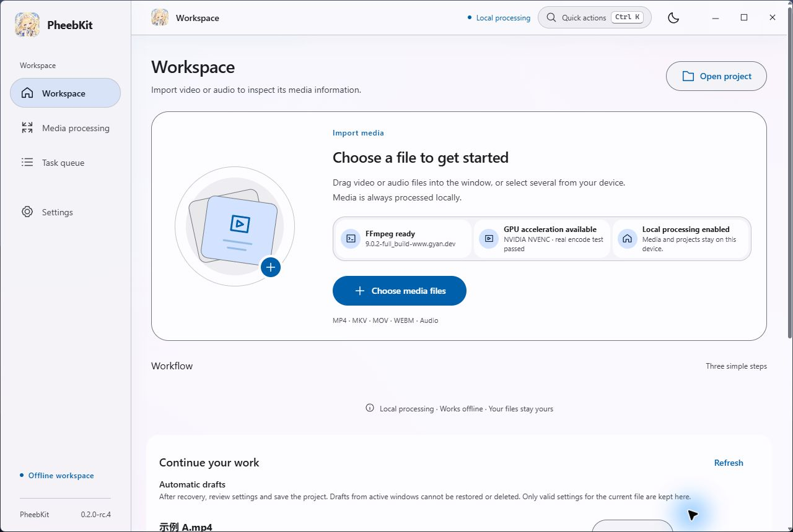
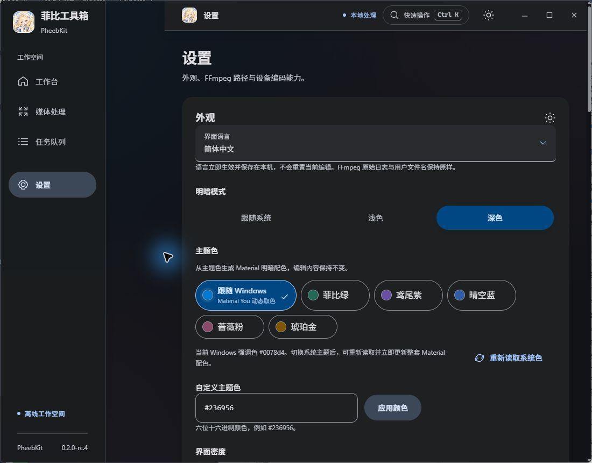
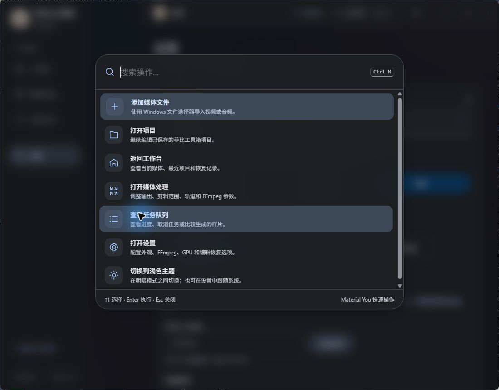
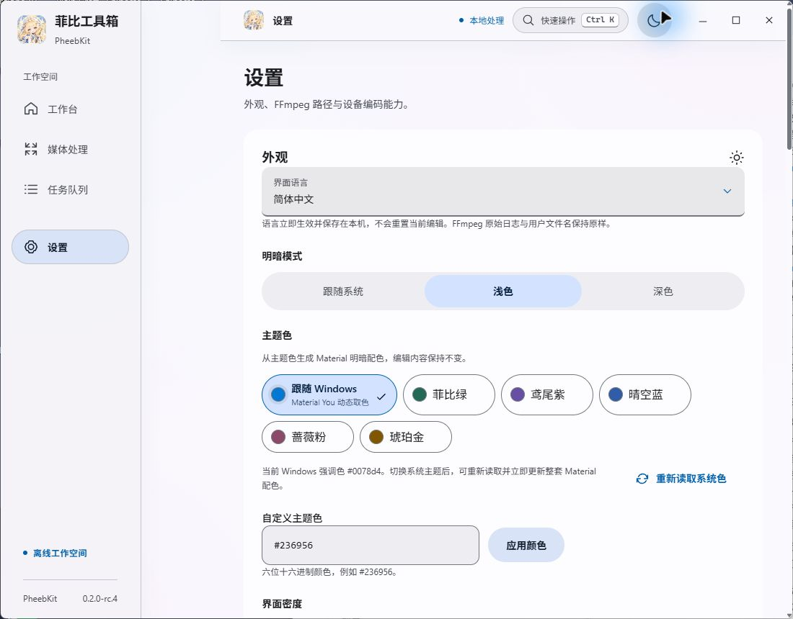
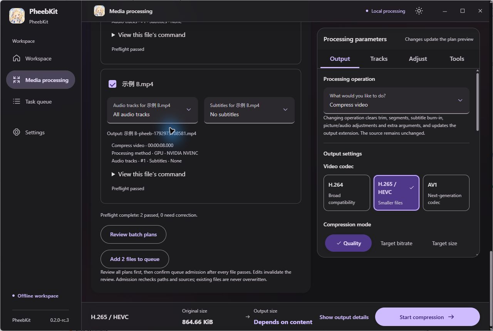
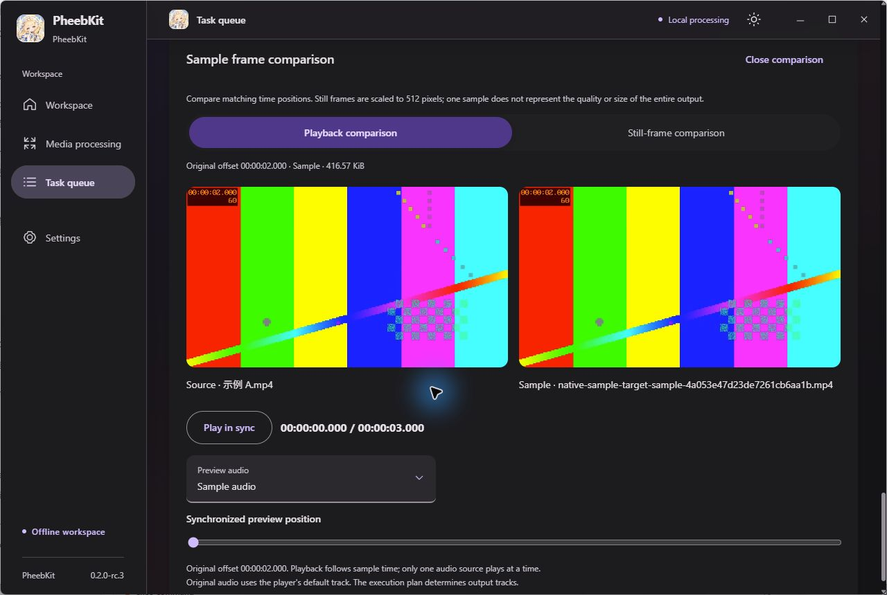

# PheebKit · 菲比工具箱

[简体中文](README.md) · [English](README.en.md)

[](https://github.com/u-fw/PheebKit/actions/workflows/windows.yml)
[](https://github.com/u-fw/PheebKit/actions/workflows/security.yml)
[](LICENSE)

A local-first Windows media toolkit powered by FFmpeg. Compress, trim, remux and process tracks with editable parameters, actual command previews and independent queued jobs. Media stays on your computer.

Built with a Go core, **stable Wails v2.17.0**, React and strict TypeScript. Targets Windows 10/11 x64; Android is deferred. Source `0.2.0-rc.6` is the process-cleanup, queue-recovery and distribution verification candidate. Downloads still retain published `rc.5`; use the separate CI candidate run for new package results. See the [stabilization evidence and remaining checks](docs/stability.md).

## Real desktop screenshots

The Material 3 / Material You workbench can follow the Windows accent, use preset or custom seeds, and switch light/dark modes, density, ripples and reduced motion. It also adds a `Ctrl+K` command palette, grouped parameters, a persistent output dock, looping, nominal frame steps, filmstrip thumbnails and bounded waveforms. The desktop app applies Compose and Material 3 design principles inside the existing React/Wails shell; a future Android client can use native Jetpack Compose. These unedited captures are from actual Wails **development builds on 2026-10-25/26**, using owned test media. They are not package or clean-client acceptance records. Simplified Chinese and English are supported. [Capture record](docs/images/README.md) · [Evidence and limits](docs/uiux-iteration.md) · [Design and feature roadmap](docs/design-roadmap.md)





<details>
<summary>Command palette, light settings, batch preflight and synchronized comparison</summary>









</details>

Earlier rc.3 captures remain in the [historical capture record](docs/images/README.md).

## Features

- **Compression and trimming:** H.264, HEVC and AV1; quality, bitrate or target-size modes; full duration, one trimmed range, or up to 16 ordered ranges from one source, joined or exported separately. Enter times directly or use selectors and sliders.
- **GPU and CPU:** prefers GPU encoding after actual NVENC/QSV/AMF trials; falls back to CPU with a visible explanation when a combination is unavailable.
- **Material You workspace:** follows the Windows accent or a custom HCT seed, with an expanded sidebar, navigation rail, compact bottom bar, first-run FFmpeg/GPU/CPU readiness, active-job control and `Ctrl+K` quick actions.
- **Picture and audio:** resolution, crop, rotation and flip; track selection, gain, loudness normalization, denoise, EQ, fades, sample rate and channel conversion.
- **Containers and subtitles:** compatible stream-copy remux; audio/text-subtitle extraction; embedded or external text subtitle burn-in with editable style and timing.
- **Jobs and projects:** batch import, reusable recipes and per-file preflight, serial scheduling, cancellation, waiting-job reordering and scheduling pause; sample comparisons, projects/presets, Undo/Redo, checkpoints and explicit recovery.
- **Windows background feedback:** mirrors active jobs in the taskbar and sends one completion/failure notification only while minimized or unfocused. Opening it restores the window and locates the corresponding queue item.
- **Damaged media:** bounded decode-window scans, reviewed deletion of failed intervals by default, or black/silent replacement to preserve duration. Recovery output must pass a complete decode. Missing content cannot be reconstructed.
- **FFmpeg setup:** reuse installed tools or explicitly download with progress, cancellation/retry and a custom HTTPS archive option requiring publisher SHA-256. Supports ZIP, 7z, RAR, tar and gzip/xz/bzip2 tar variants.

Multi-file timelines, HDR output, unrestricted commands/filter graphs, network/live capture and FFmpeg process pause/resume are outside this release. [Media policies](docs/media-tools.md) · [Audio controls](docs/audio-processing.md) · [Recovery contract](docs/media-recovery.md) · [Expansion scope](docs/ffmpeg-expansion.md)

## Installation and FFmpeg

Releases provide four usage modes plus SHA-256 sums and GitHub build provenance:

- `PheebKit-<version>-windows-x64.exe`: lightweight direct-run application using external FFmpeg.
- `PheebKit-<version>-windows-x64-ffmpeg.exe`: single-file direct-run application with embedded FFmpeg 9.0.2.
- `PheebKit-<version>-windows-x64-portable-ffmpeg.zip`: complete portable package with `runtime/ffmpeg`.
- `PheebKit-<version>-windows-x64-setup-ffmpeg.exe`: optional installer with embedded FFmpeg.

The embedded single-file build atomically verifies and extracts its runtime to `%LOCALAPPDATA%/PheebKit/runtime/ffmpeg` on first launch, then reuses it. The ZIP uses FFmpeg and ffprobe from its adjacent runtime directory. All editions require Microsoft WebView2 Runtime, so bundled FFmpeg is not a fully offline guarantee. Final downloads appear in [GitHub Releases](https://github.com/u-fw/PheebKit/releases); Actions artifacts are verification candidates.

Later release assets include Sigstore build provenance binding the repository, workflow, commit and file digests. With GitHub CLI installed, verify a downloaded file:

```powershell
gh attestation verify .\PheebKit-<version>-windows-x64.exe --repo u-fw/PheebKit
```

Provenance complements, but does not replace, the SHA-256 manifest, publisher code signing or clean-machine acceptance. The earlier `rc.5` publication predates this mechanism and is not represented as retroactively attested.

The lightweight build can download FFmpeg or select local executables in Settings; downloads are disabled while both tools are usable. The default uses the FFmpeg-recommended Gyan stable build, trying gyan.dev and then the same-version GitHub release. The older domestic fallback requires explicit selection and never silently downgrades. Custom archives require an explicit source-trust confirmation and publisher SHA-256. [Download and validation policy](docs/ffmpeg-downloads.md)

Discovery order: `PHEEBKIT_FFMPEG` / `PHEEBKIT_FFPROBE` → `FFMPEG_PATH` / `FFPROBE_PATH` → saved application settings → bundled runtime → PATH. Values may identify an executable or its directory. Correct explicit overrides in the environment and restart the app. System PATH is never modified.

Public environment variables use `PHEEBKIT_*`. New settings live in `%APPDATA%/PheebKit`; private downloads use `%LOCALAPPDATA%/PheebKit/tools`. An isolated compatibility layer reuses existing data and old overrides without deleting files. See [namespace migration and compatibility](docs/compatibility.md). Third-party version, copyright and filename output remains unchanged.

## Development and verification

Requires Windows x64, PowerShell 7, Node 24+ and Go 1.26+ with automatic selection of the pinned Go 1.27.3 toolchain. Release builds enforce Go 1.27.3+. Use the exact Wails CLI and retain the lockfiles:

```powershell
go install github.com/wailsapp/wails/v2/cmd/wails@v2.17.0
npm --prefix frontend ci
wails generate module
node scripts/normalize-bindings.mjs
npm --prefix frontend run build
./scripts/test-go.ps1
npm --prefix frontend run test
npm --prefix frontend run typecheck
npm --prefix frontend run lint
npm --prefix frontend run format:check
./scripts/build-windows.ps1
```

Real-media tests require verified FFmpeg tools and `PHEEBKIT_INTEGRATION=1`. Packaging checks source and both final-binary vulnerabilities, frontend quality and clean sources. `.github/workflows/security.yml` also audits lockfiles, npm and reachable Go vulnerabilities on dependency changes, a weekly schedule and manual dispatch. Acceptance checks both direct EXEs, the portable ZIP, the installer, runtime provenance, first-extraction reuse, install/reinstall/uninstall and user-data preservation. Hosted Windows Server checks do not establish Windows 10/11 client UI acceptance. [Verification steps](docs/release-acceptance.md) · [Windows distribution](docs/windows-distribution.md)

Key directories: `internal/core` defines media/projects/plans; `internal/compiler` validates and compiles arguments; `internal/runner/windows` manages actual processes; `internal/processguard` binds FFmpeg and descendant lifecycles; `internal/app` provides the native service boundary; `frontend` supplies the interface. [Architecture](docs/architecture.md) · [Project format](docs/project-format.md) · [UI design](docs/ui-design.md)

## Contributing and license

Original code is licensed under **GNU GPL v3 only (`GPL-3.0-only`)**. See [LICENSE](LICENSE). Bundled editions use a publisher-pinned and independently verified Gyan 9.0.2 full GPL v3 build, with FFmpeg's license, README, hashes and corresponding-source URL included. Third-party dependencies and assets retain their own licenses.

[Contributing](CONTRIBUTING.md) · [Private security reporting](SECURITY.md) · [Release notes](RELEASE_NOTES.md) · [Issues](https://github.com/u-fw/PheebKit/issues)
