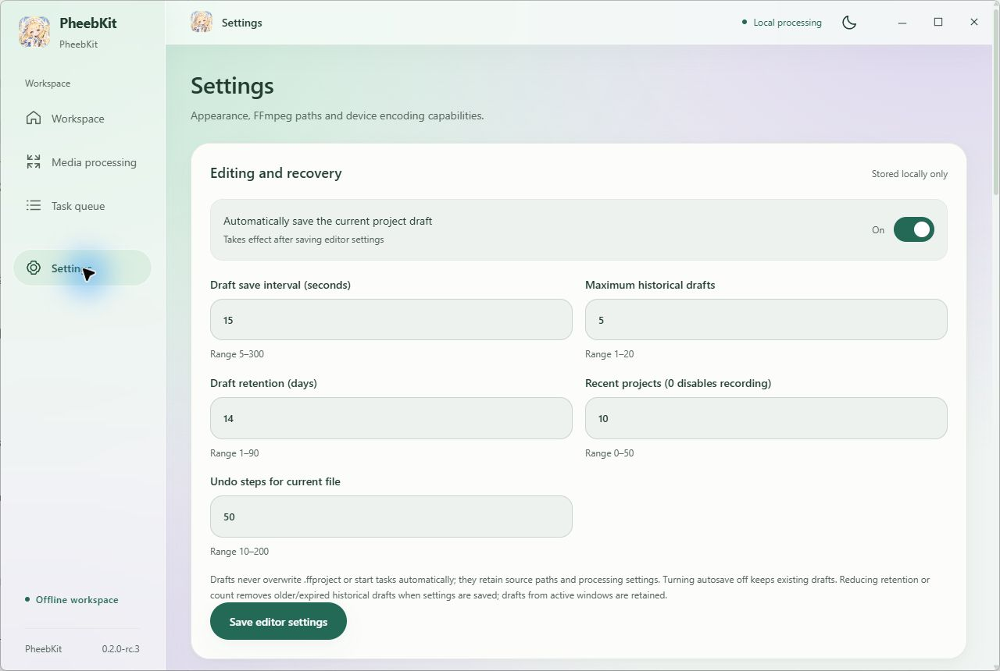
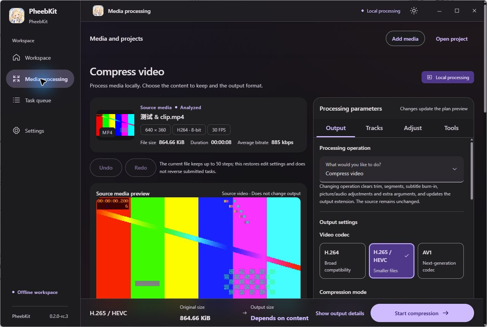
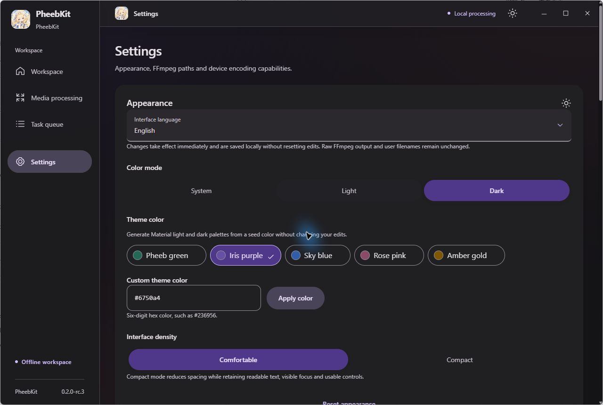

# 菲比工具箱 · PheebKit

[简体中文](README.md) · [English](README.en.md)

[](https://github.com/u-fw/PheebKit/actions/workflows/windows.yml)
[](LICENSE)

本地优先的 Windows 媒体工具。用 FFmpeg 完成压缩、剪辑、转封装与轨道处理，提供可修改的参数、真实执行预览和独立任务队列。媒体无需上传。

技术栈：Go 核心、**稳定版 Wails v2.17.0**、React 与严格 TypeScript。目标平台为 Windows 10/11 x64；Android 暂缓。当前 `0.2.0-rc.3` 用于稳定版验收，尚未发布正式版安装包；已验证范围和缺口见[稳定化记录](docs/stability.md)。

## 实际运行截图

2026-10-18 在 Windows 11 桌面候选程序上的原始截图，使用自建的 8 秒 H.264/AAC 测试视频。界面支持简体中文和 English，可在设置中即时切换并保存偏好。[截图与实测说明](docs/images/README.md)




当前源码正在迭代 Material 3 / Material You 工作台：可切换明暗、自定义主题色与界面密度，分组参数和固定输出栏，另有循环预览、按帧微调、时间轴缩略图与有界波形。下面为 2026-10-25 **开发构建**的真实窗口，尚未替换上述 rc.3 验收包。[进度与验证范围](docs/uiux-iteration.md)





## 可以做什么

- **压缩与剪辑**：H.264、HEVC、AV1；质量、目标码率、目标体积；完整视频、单区间剪辑、最多 16 个同源片段拼接或分段输出。时间可直接输入或使用选择器、滑块微调。
- **GPU 与 CPU**：默认优先 GPU，经实际试编码确认 NVENC/QSV/AMF 可用性；不可用时回退 CPU，并显示原因。
- **画面与声音**：分辨率、裁剪、旋转、翻转；音轨选择、音量、归一化、降噪、均衡、淡入淡出、采样率与声道设置。
- **封装与字幕**：兼容流无重编码转封装，音频与文字字幕提取；内嵌或外部文字字幕烧录，支持样式和时间偏移。
- **任务与项目**：批量导入、串行队列、取消、调整等待顺序、暂停后续调度；样片对比、项目/预设、撤销/重做、自动草稿与显式恢复。
- **损坏媒体恢复**：逐窗口解码检查，默认删除确认的失败区间，也可用黑画面/静音保留时长；恢复输出必须完整解码通过。无法重建已丢失的内容。
- **环境补全**：复用已有 FFmpeg；缺失时可显式下载、查看进度、取消重试，或填写带 SHA-256 的自定义 HTTPS 压缩包链接。支持 ZIP、7z、RAR、tar、gzip/xz/bzip2 的 tar 变体。

多文件时间线、HDR 输出、任意命令/滤镜图、网络/直播采集和 FFmpeg 进程暂停/续跑不在本版范围。[媒体工具](docs/media-tools.md) · [音频处理](docs/audio-processing.md) · [恢复策略](docs/media-recovery.md) · [扩展范围](docs/ffmpeg-expansion.md)

## 使用与安装

候选包包含 Setup、免安装 ZIP 和 SHA-256 清单；免安装包需完整解压后运行，并仍将设置保存在 AppData。正式下载发布后以 [GitHub Releases](https://github.com/u-fw/PheebKit/releases) 为准；Actions 构建产物是验收候选。

需要 Microsoft WebView2 Runtime 与可用的 FFmpeg/ffprobe。FFmpeg 不内置在应用安装包中。缺失时在设置中下载或选择本机文件；已找到可用工具时禁止重复下载。默认来源为 FFmpeg 官网推荐的 Gyan 稳定构建，先尝试 gyan.dev，再尝试同版 GitHub 线路；国内旧版备用源需手动选择，不静默降级。自定义包必须明确确认来源并提供发布者 SHA-256。[下载与安全策略](docs/ffmpeg-downloads.md)

FFmpeg 查找顺序为 `PHEEBKIT_FFMPEG` / `PHEEBKIT_FFPROBE` → `FFMPEG_PATH` / `FFPROBE_PATH` → 应用设置 → PATH。环境变量可指向程序或所在目录；显式覆盖需在环境中修正并重启应用。系统 PATH 不会被修改。

公开环境变量使用 `PHEEBKIT_*`，新安装的设置位于 `%APPDATA%/PheebKit`，私有下载位于 `%LOCALAPPDATA%/PheebKit/tools`。早期安装由隔离兼容层读取既有数据与旧变量，不删除旧文件。详见[命名迁移与兼容](docs/compatibility.md)。第三方工具的版本、版权和文件名保持原样。

## 开发与验证

需要 Windows x64、PowerShell 7、Node 24+，以及 Go 1.26+（自动选择固定的 Go 1.27.2 工具链）；正式构建强制要求 Go 1.27.2+。使用固定 Wails CLI 并保留仓库锁文件：

```powershell
go install github.com/wailsapp/wails/v2/cmd/wails@v2.17.0
npm --prefix frontend ci
wails generate module
node scripts/normalize-bindings.mjs
npm --prefix frontend run build
go test ./...
go vet ./...
npm --prefix frontend run test
npm --prefix frontend run typecheck
npm --prefix frontend run lint
npm --prefix frontend run format:check
./scripts/build-windows.ps1
```

真实 FFmpeg 回归需要经校验的测试工具和 `PHEEBKIT_INTEGRATION=1`。发布脚本执行源码与最终 EXE 漏洞扫描、前端检查和干净源码校验；安装验收检查安装/重装/卸载、运行保护、校验和及用户数据保留。GitHub 托管 Windows Server 检查不等于 Windows 10/11 客户端界面验收。[验证步骤](docs/release-acceptance.md) · [Windows 打包](docs/windows-distribution.md)

核心目录：`internal/core` 定义媒体/项目/执行计划，`internal/compiler` 生成经过验证的参数，`internal/runner/windows` 管理真实进程，`internal/app` 提供原生服务边界，`frontend` 提供界面。[架构](docs/architecture.md) · [项目格式](docs/project-format.md) · [界面设计](docs/ui-design.md)

## 参与与许可证

代码采用 **GNU GPL v3 only (`GPL-3.0-only`)**，详见 [LICENSE](LICENSE)。第三方依赖和素材保留各自许可证；FFmpeg 的下载或分发仍需遵守其自身许可证与源码/声明义务。

[贡献指南](CONTRIBUTING.md) · [私密安全反馈](SECURITY.md) · [更新记录](RELEASE_NOTES.md) · [问题反馈](https://github.com/u-fw/PheebKit/issues)
