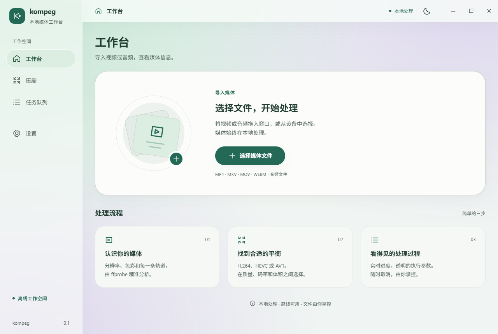

# kompeg

A Windows 10/11 and Android video-processing technical spike using Go Core, Wails v3, React and strict TypeScript. Windows uses real installed FFmpeg binaries. The Android runner is an explicit unsupported mock until the native integration milestone.

Wails `v3.0.0-beta.27` and its experimental Android shell were explicitly approved for this spike. This repository is not a production release. [Environment audit](docs/environment.md) and [Android blockers](docs/android.md) distinguish installed tools, source support and actual runtime evidence.



## Windows development

Requires Go 1.25+, Node 24+, WebView2 and FFmpeg/ffprobe with a supported software or usable hardware encoder. Install the exact CLI once:

```powershell
go install github.com/wailsapp/wails/v3/cmd/wails3@v3.0.0-beta.27
npm --prefix frontend ci
wails3 generate bindings -ts -i -clean=true
npm --prefix frontend run build
wails3 build
.\bin\kompeg.exe
```

`wails3 build` generates the Windows manifest/resource and embeds the production frontend. The manifest enables long paths; filesystem policy and the installed FFmpeg build still determine complete long-path support. For optional explicit binary selection:

```powershell
$env:KOMPEG_FFMPEG = 'D:\Tools\ffmpeg\bin\ffmpeg.exe'
$env:KOMPEG_FFPROBE = 'D:\Tools\ffmpeg\bin\ffprobe.exe'
```

Use `wails3 dev -config build/config.yml` for frontend development. Ordinary browser previews cannot execute native operations. Drag a video onto the workspace or use the file picker, review media details, configure compression, inspect the backend command preview, start a job and follow progress/cancel/results in Queue.

FFmpeg discovery prefers `KOMPEG_FFMPEG` / `KOMPEG_FFPROBE`, then `FFMPEG_PATH` / `FFPROBE_PATH`, then application settings and PATH. Values can identify the executable or its directory. Missing/invalid binaries show a setup prompt; Settings lets you download a verified Windows x64 package or select `ffmpeg.exe` and verifies its sibling `ffprobe.exe`. Paths are saved in `%APPDATA%/kompeg/ffmpeg.json`, without modifying Windows environment variables. Explicit environment overrides must be corrected in the environment and require restarting the app. Reconfiguration is blocked while jobs are active.

One-click setup offers Gyan 9.0.2 full stable builds and the older npmmirror 6.1.1 domestic fallback. The default tries gyan.dev first, then the matching GitHub release. Domestic fallback must be selected manually after a failure; it never silently downgrades. Versions, transfer progress, cancellation and retry are visible. Downloads use fixed SHA-256 digests, preserve upstream notices, and install privately under `%LOCALAPPDATA%/kompeg/tools`. See [download policy and verification](docs/ffmpeg-downloads.md).

Settings also accepts a custom HTTPS archive download link. Mirrors of the exact built-in Gyan full ZIP retain its pinned digest. Other Windows x64 builds require a publisher-provided SHA-256 and explicit source trust; kompeg automatically finds a single FFmpeg/ffprobe pair, preserves sidecar DLLs, validates and configures it. ZIP, 7z, RAR, tar, tar.gz/tgz, tar.xz and tar.bz2/tbz2 are detected by file contents without requiring an external extractor. Download pages, source-only/Linux builds, encrypted or split archives and self-extracting executables are unsupported.

New compression settings default to GPU preference. NVENC, QSV and AMF are offered only after bounded real encoding trials; unavailable combinations fall back to CPU with a visible reason. Source artwork prefers Windows thumbnail providers and falls back to FFmpeg cover/frame extraction.

## Verification commands

```powershell
go test ./...
go vet ./...
$env:KOMPEG_INTEGRATION = '1'
go test ./internal/runner/windows -v
Remove-Item Env:\KOMPEG_INTEGRATION
npm --prefix frontend run test
npm --prefix frontend run typecheck
npm --prefix frontend run lint
npm --prefix frontend run format:check
wails3 build
```

`go run ./cmd/spike -input <absolute-path> -output <new-absolute-path.mp4>` verifies the same probe/compiler/runner slice without the UI and prints actual media/result JSON.

## Structure

```text
cmd/spike/                  real Windows headless verification command
internal/app/               Wails service, events, platform factories
internal/core/              shared Media, Project IR, plan, job and Runner
internal/probe/              ffprobe JSON decoder
internal/capabilities/       dynamic encoder registry
internal/compiler/          validation, argv and command preview
internal/project/           schema-versioned project persistence
internal/presets/           versioned preset definitions
internal/jobs/              independent job records and serial worker queue
internal/runner/windows/    real process, progress/log parsing and cancellation
internal/runner/android/    explicitly unsupported mock/native boundary
frontend/                   shared React UI, tokens and generated TS bindings
platform/android/           JNI/SAF native integration plan
platform/windows/           Windows adapter and distribution notes
build/windows/              manifest, icon and executable metadata
build/android/              pinned upstream task reference; toolchain required
docs/                       architecture, design and verification evidence
```

See [architecture](docs/architecture.md), [UI design](docs/ui-design.md), [runner](docs/ffmpeg-runner.md), [project format](docs/project-format.md), [Android FFmpeg spike](docs/android-ffmpeg-spike.md) and [actual verification](docs/verification.md).

The [open-source readiness review](docs/open-source-readiness.md) records repaired defects, verification and remaining publication decisions.

## License

kompeg's original code is licensed under the GNU General Public License version 3 only (`GPL-3.0-only`). See [LICENSE](LICENSE) for the full terms. Third-party dependencies and assets retain their respective licenses. FFmpeg is currently discovered locally rather than bundled; packaging or downloading FFmpeg does not replace its own license or distribution obligations.

## Current scope

Home, Media Card and thumbnails, environment setup, qualified GPU/CPU selection, SDR compression settings, limited advanced argv, command preview, queue, real cancel and result metrics form the first vertical slice. Remux/extract/editing, HDR encoding, unrestricted Raw Command, all component scanners, process pause/resume and project/preset management UI are later milestones. Windows FFmpeg is discovered rather than bundled; distribution licensing/packaging must be decided before release.

Android SDK/NDK/emulator and a connected device are absent on the audited machine. The pinned Android task assets also require a POSIX build host. APK build, Android Go binding and native FFmpeg execution are therefore not verified; responsive UI reuse alone does not satisfy those criteria.
