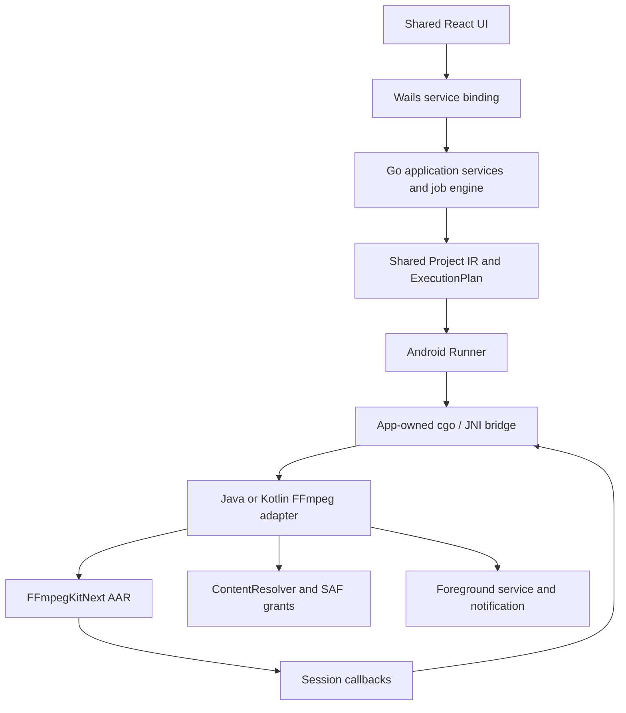

# Android FFmpeg integration spike

Research baseline: 2026-10-09. This document records verified upstream contracts and an implementation proposal. No FFmpegKitNext AAR has been built or added, and no Android FFmpeg command has run locally. Complete the Android Wails launch/binding milestone in [android.md](android.md) before starting native integration.

## Candidate and evidence

[FFmpegKitNext](https://github.com/arthenica/ffmpeg-kit-next) is the official Arthenica continuation of FFmpegKit. [v9.0.0](https://github.com/arthenica/ffmpeg-kit-next/releases/tag/v9.0.0) is a non-prerelease source release based on FFmpeg 9.0.1. It has no prebuilt binaries. Do not invent a Maven Central coordinate that resolves without a locally produced repository.

| Required capability | Verified upstream contract | Local verification |
| --- | --- | --- |
| Android AAR | Builds native libraries and local Maven repository | Not built/integrated |
| `arm64-v8a` | Listed supported ABI; Android API 24+ | No arm64 device run |
| FFmpeg argv execution | `executeWithArgumentsAsync` with independent argument array | Not run |
| FFprobe | Argument-array execution and media-information JSON API | Not run |
| Progress/logs | Per-session statistics and log callbacks | Not run |
| Cancel | `cancel(sessionId)` and completion return code | Not run |
| SAF input/output | Read/write helpers register document URIs as `ffkitsaf:` | Not run |
| H.264/H.265 | Software libraries are optional; upstream MediaCodec encoder implementations exist | Build/device encoder availability unknown |
| Output artifact | Local path or registered writable document reference | No artifact produced |

The [v9.0.0 Android README](https://github.com/arthenica/ffmpeg-kit-next/blob/v9.0.0/android/README.md), [FFmpeg API](https://github.com/arthenica/ffmpeg-kit-next/blob/v9.0.0/android/ffmpeg-kit-next-android-lib/src/main/kotlin/com/arthenica/ffmpegkit/FFmpegKit.kt), [FFprobe API](https://github.com/arthenica/ffmpeg-kit-next/blob/v9.0.0/android/ffmpeg-kit-next-android-lib/src/main/kotlin/com/arthenica/ffmpegkit/FFprobeKit.kt) and [statistics model](https://github.com/arthenica/ffmpeg-kit-next/blob/v9.0.0/android/ffmpeg-kit-next-android-lib/src/main/kotlin/com/arthenica/ffmpegkit/Statistics.kt) provide the versioned source evidence.

The local Maven output is `com.arthenica:ffmpeg-kit-next:9.0.0`, generated under `prebuilt/bundle-android-aar-24-maven`. Its POM carries transitive dependencies, so consume that repository rather than copying an AAR and silently omitting dependencies. The `smart-exception-java:0.2.1` [official Maven Central POM](https://repo.maven.apache.org/maven2/com/arthenica/smart-exception-java/0.2.1/smart-exception-java-0.2.1.pom) was checked successfully; that does not imply the FFmpegKitNext AAR is available there.

## Problems, causes and options

| Problem | Cause | Possible solution | Recommendation |
| --- | --- | --- | --- |
| Local Android runtime remains unverified | SDK/NDK/emulator not found; no connected adb device | Inspect WSL or provide a supported host/toolchain and device | Finish the shell spike first |
| Native Windows cannot produce Next's Android AAR through a supported official workflow | Android native build scripts list Linux/macOS hosts; releases are source-only | Linux build host, macOS host, or tested WSL environment | Use a pinned Linux/Nix build environment; inspect existing Debian first |
| Pinned Wails tasks do not implement native Windows Android compilation | beta.27 Taskfile only handles Linux/Darwin | Linux host or a small, tested build adapter | Prefer Linux for the initial pin; retain Windows desktop build |
| Wails Go does not expose a general public Java-call API | Framework JNI helpers are package-private | App-owned JNI bridge; direct native FFmpeg wrapper; upstream extension | App-owned bridge initialized by the Android host |
| Picker behavior is unsuitable for URI-preserving large-media jobs | Built-in Wails picker copies documents into cache and returns a path | Native SAF picker; explicit bounded cache import | Native picker and original URI preservation |
| Wails save-file/directory dialog is unsupported | Current Android runtime contract | `ACTION_CREATE_DOCUMENT`; sandbox output followed by export | Explicit native output picker/export adapter |
| Minimum SDK mismatch | Wails template is 21; Next library is 24 | Raise native-stage minimum SDK to 24 | Align Go compiler API level, Gradle minSdk and AAR at 24 |
| Different NDK baselines | Wails docs/tasks use 26.3; Next tests r27d | Keep toolchains separate and test packaged outputs; deliberate later alignment | Do not silently replace either baseline |
| Encoder names alone cannot prove successful hardware encoding | Actual device MediaCodec capabilities vary | Scan native build and Android codec capabilities, then perform short encode | Validate H.264/H.265 at runtime; expose only working choices |
| Activity teardown can outlive a native callback | Jobs and Go/Java runtimes have independent lifetimes | Managed adapter lifetime, cancellation, bounded callback queue | Own the bridge in the platform service and reject stale callbacks |

See [Next Host Support](https://github.com/arthenica/ffmpeg-kit-next/wiki/Host-Support), [NDK Compatibility](https://github.com/arthenica/ffmpeg-kit-next/wiki/NDK-Compatibility), [Wails beta.27 JNI implementation](https://github.com/wailsapp/wails/blob/v3.0.0-beta.27/v3/pkg/application/application_android.go) and [Wails beta.27 Gradle configuration](https://github.com/wailsapp/wails/blob/v3.0.0-beta.27/v3/internal/commands/build_assets/android/app/build.gradle). WSL2 is technically plausible for Next builds but is outside its tested host matrix; an installed Debian distribution is not build evidence.

## Recommended architecture

This is a proposal, not code already in the repository. Go retains validation, compilation, queue state and business rules. The native adapter owns FFmpeg sessions, Android resources and lifecycle. No React component builds FFmpeg arguments, and no Android business service starts a shell or assumes a Windows-style executable.

The host initializes an app-owned native bridge with a JavaVM and a global adapter reference. Calls originating on Go threads attach/detach through that bridge. Native completion/progress/log callbacks return a job ID and session ID to Go; the existing job engine emits throttled frontend events. Keep locks out of reentrant JNI calls, copy callback payloads before releasing JNI references, and release references and pending work during shutdown. Do not use private Wails functions through linker tricks or patch the framework merely to reach its stored bridge.

Map `core.Runner` as follows:

- `Probe`: resolve the source reference, execute JSON ffprobe off the UI thread, and pass JSON through the shared Go parser. Preserve the required format/streams/chapters/programs output.
- `Capabilities`: inspect the actual bundled FFmpeg version/build/encoders; supplement MediaCodec with Android codec discovery and a short runtime check.
- `Start`: turn source references into temporary native URLs, pass the execution plan's independent argv array, associate the returned native session ID with the Go job, and await completion off the UI thread.
- `Cancel`: cancel only the mapped session. Cancellation is asynchronous; keep the Go job in `cancelling` until completion acknowledges success, cancel or failure. A cancel request does not equal a completed cancellation.

Statistics carry frames, fps, output bytes, time, bitrate and speed. Normalize native units explicitly with a known-duration sample before projecting them into `core.Progress`; clamp display progress and finalize state only on the completion callback. Retain bounded logs and ignore late events from a previous job/session.

## SAF and output plan

1. Native `ACTION_OPEN_DOCUMENT` selection returns the original `content://` URI, display name, available size and grant flags. Request/persist grants when the provider permits them; handle revoked grants and cloud-backed documents explicitly.
2. Project IR keeps `Source{kind: "content-uri", uri, displayName}`. Grants and open descriptors stay in the Android adapter. A restored project must revalidate permission instead of assuming persisted JSON restores access.
3. Use `getSafParameterForRead` or `getSafParameterForWrite`; never invent `ffkitsaf:` URLs. They are registered descriptors, not filesystem paths. URLs are single-use by default: create a fresh URL per probe/encode, or use reusable registration and unregister when finished. See [SAF protocol](https://github.com/arthenica/ffmpeg-kit-next/wiki/FFmpegKit-SAF-Protocol).
4. Prefer an app-sandbox temporary output for a complete, seekable encoding, then export using `ACTION_CREATE_DOCUMENT`. Report encoding and export as distinct steps, keep a recoverable file on export failure, and clean cancelled temporary output. Require available-space checks before this path.
5. Direct SAF output is an optimization to test separately for writable/seekable provider behavior. Set the muxer explicitly when a native URL does not give FFmpeg a reliable extension. Test MP4 finalization and provider failures before promising direct export.
6. Probe the completed output and verify duration, video codec, audio policy and actual output bytes. A return code alone does not establish a valid or smaller output.

## H.264/H.265 build and runtime choices

For deterministic software tests, enable x264 and x265 explicitly in a local build using `--enable-lib-x264`, `--enable-lib-x265` and `--enable-gpl`. The resulting bundle is GPL v3 rather than the default LGPL v3 variant. Record exact tag, options, toolchain, native dependency versions, licenses and checksums with the artifact. The choice of distribution variant belongs to the native integration milestone. See the [versioned build script](https://github.com/arthenica/ffmpeg-kit-next/blob/v9.0.0/android.sh) and [versioned project README](https://github.com/arthenica/ffmpeg-kit-next/blob/v9.0.0/README.md).

For hardware tests, FFmpeg 9.0.1 defines [H.264 and HEVC MediaCodec encoders](https://github.com/FFmpeg/FFmpeg/blob/n9.0.1/libavcodec/mediacodecenc.c). Build with MediaCodec enabled and test each device's formats, rate control and encoder availability. Software CRF/preset options cannot be assumed valid for MediaCodec. An emulator success is not evidence of physical-device HEVC hardware support. AV1 remains outside this spike.

## Native packaging and background work

Next's v9.0.0 arm64/x86_64 [linker setup](https://github.com/arthenica/ffmpeg-kit-next/blob/v9.0.0/scripts/function-android.sh) includes 16 KB maximum-page-size alignment. Inspect every final native library, including `libwails.so` and C++ runtime dependencies, and APK/AAB ZIP alignment, then test a 16 KB page-size device/emulator. Source flags alone do not verify the final artifact. See [Android page-size guidance](https://developer.android.com/guide/practices/page-sizes).

Long jobs need a foreground service, notification and platform-owned cancellation. Handle Android 15 `mediaProcessing` foreground-service timeouts; the documented background allowance is six hours in a 24-hour period. Preserve terminal job state on timeout and stop native work cleanly. See [Android foreground-service timeouts](https://developer.android.com/develop/background-work/services/fgs/timeout).

The inherited Wails Android template includes native feature dependencies, including `androidx.security:security-crypto:1.1.0-alpha06`. Approval of Wails Beta does not establish approval of unrelated prerelease dependencies. Audit these template dependencies before the Android build milestone; replace or remove them through a tested, scoped change rather than silently adding experimental libraries.

## Native acceptance gate

After the shell/binding milestone passes, require a real arm64 run that selects a SAF document, probes it, encodes H.264 and H.265, reports changing progress, cancels a running session, exports output and probes the result. Record ABI/API level, build options, device codec capabilities, return codes, artifact sizes, callback units and logs. Cover Unicode names, permission loss, insufficient storage, cancellation during preparation/export, app backgrounding and provider failure. Keep x86_64 emulator testing separate from arm64 evidence.

If a tested app-owned bridge proves structurally incompatible with Wails, record the specific failing contract, reproducible build/runtime evidence and options before changing the shell. Direct native FFmpeg is the next alternative. Flutter/native Android plus gomobile AAR is a future decision requiring an explicit architectural change; the current Go Core boundary allows it without rewriting business logic.

