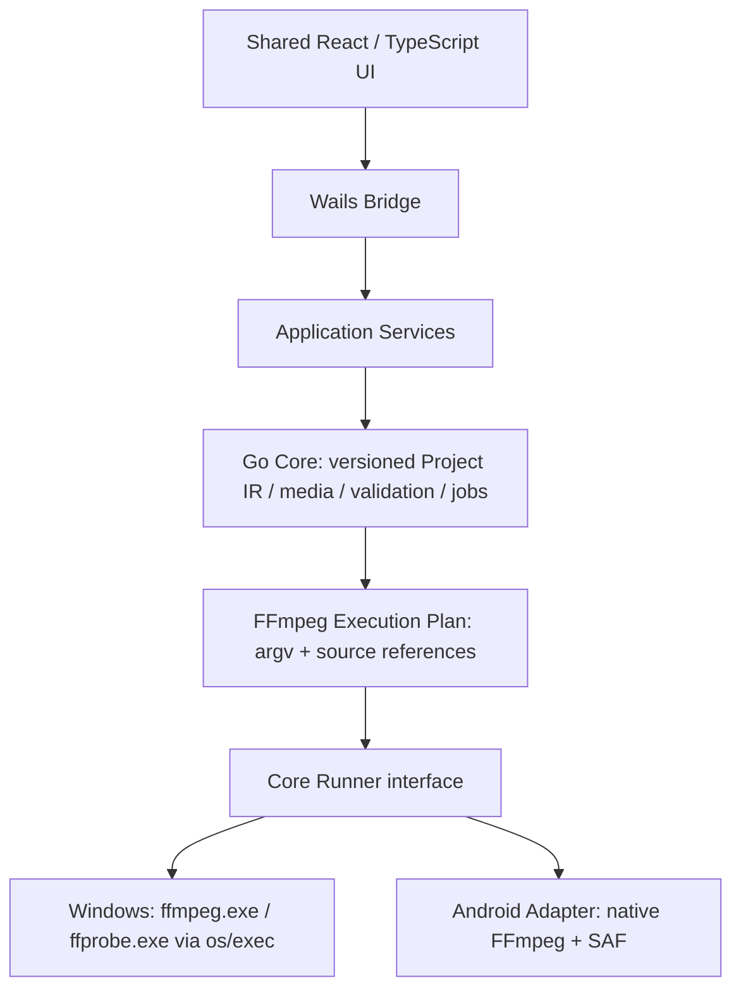

# PheebKit architecture

The first milestone is a technical spike, not the complete product. Windows 10/11 x64 is the active target; Android is deferred. Wails v3 Beta and experimental Android support were explicitly approved for this spike on 2026-10-09; they are not a production stability claim.

## Boundaries

- `internal/core` owns the shared models and runner interface. It imports neither Wails nor platform process APIs.
- `internal/probe` parses ffprobe JSON. `internal/capabilities` parses actual FFmpeg encoder capabilities.
- `internal/compiler` validates Project IR and produces argv. Command preview is display-only and is never executed through a shell.
- `internal/jobs` owns a queue of independent job records, cancellation, bounded logs and throttled progress events.
- `internal/runner/windows` owns process execution, stdout progress, stderr logs and Windows process options.
- `internal/runner/android` is an explicitly unsupported adapter during the first spike. No fabricated compression results are returned.
- `internal/app` connects services and events to Wails; platform factories use Go build constraints.
- `frontend` contains the shared Media Card, compression form and queue. The bridge converts generated bindings into the UI API.
- `platform/android` documents the native JNI/SAF boundary. It may replace the shell without rewriting Core.

## Media and execution

`Source` distinguishes local filesystem paths from `content://` document URIs. The original reference belongs in Project IR; temporary native SAF handles belong only in the runner. UI changes Project IR, asks Go to compile a plan, and starts that same plan through the job engine.

The Windows spike discovers installed software encoders and runtime-qualifies NVENC, AMF and QSV candidates using bounded real encoding trials. Automatic selection prefers a qualified GPU, then software with a visible reason. Software HEVC and NVIDIA NVENC are verified on the audited workstation; AMD/Intel execution is not claimed.

Local media and execution plans carry an optional source fingerprint. It combines file identity, size, modification/change timestamps and bounded content samples. Probe validates it before and after inspection; preview and execution reject changed sources, and publication checks it again. This detects ordinary replacement/editing without hashing an entire multi-gigabyte video. It is not a complete content-integrity hash or a file lock.

## Persistence and compatibility

`.ffproject` JSON and presets carry `schemaVersion: 1`. Unknown versions fail explicitly. Raw arguments are separate argv elements and are an escape hatch, not the persisted primary model. The first spike does not reverse-parse edited commands into GUI state.

## Verification limits

`internal/localstore` supplies bounded atomic JSON updates and cross-process OS file locks. The app merges history by job ID, retaining live jobs from other processes. On startup, active records from dead owners become interrupted display records; no persisted argv is executed. Job snapshots retain a deep copy of the editable Project for reuse. Preferences contain only encoding settings and omit trim and file paths. Storage failures preserve the original file and surface in the UI.

Preview assets are served by an app handler using opaque session tokens issued only for imported media. Every GET/HEAD checks the source fingerprint and supports byte ranges; arbitrary path query parameters are not accepted. FFmpeg frame extraction shares the bounded thumbnail worker gate. The native close hook and application quit hook consult backend work state; confirmed exit cancels the job engine.

Windows gets real process, probe, encode and cancel tests. Android execution and Go binding cannot be called verified without an APK build and device/emulator run. A responsive browser viewport alone verifies layout sharing, not an Android native runtime.
