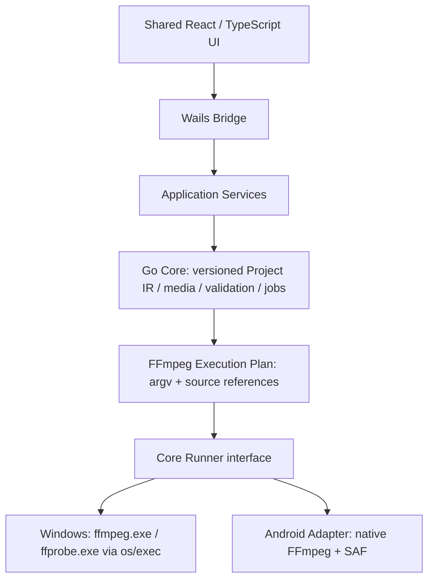

# PheebKit architecture

Beta.11 adds typed optional audio-processing IR, compiled only for encoded compression/audio extraction. Explicit sample-format/rate adapters surround filters so the existing strict video pixel-format policy cannot disable needed audio conversions. Concat applies effects to each joined output track, rather than independently fading/normalizing every source interval. New sample-rate/channel probe fields support pre-publication verification. Core snapshots deep-copy normalization/EQ data; samples validate original fades then omit whole-output envelopes. See [audio contract and evidence](audio-processing.md).

Beta.9 adds an optional `MediaHealthScanner` for bounded local CPU decode windows. Service admits one scan, snapshots its result, provides cancellable progress, binds it to the source fingerprint and joins it on shutdown. Active scans guard configuration replacement and native close. Reports live in memory; editable `Settings.Recovery` persists reviewed intent. Compilation validates a chronological complement/replacement timeline with at most 16 pieces. Delete reuses the range-concat graph; preserve-duration uses typed `color`/`anullsrc` sources and explicit stereo resampling. A recovery plan forces complete output decoding after structure/duration checks and before atomic no-overwrite publication. See [recovery contract](media-recovery.md).

The first milestone is a technical spike, not the complete product. Windows 10/11 x64 is the active target; Android is deferred. Wails v3 Beta and experimental Android support were explicitly approved for this spike on 2026-10-09; they are not a production stability claim.

Beta.8 keeps the same architecture: ordered ranges and typed subtitle styles are editable Project IR. The compiler emits a bounded same-source seek/concat graph and freezes any subtitle asset identity. The Windows runner prepares a generated ASS file through restricted input/forced text formats, captures at most 32 MiB and refuses prepared subtitles above 16 MiB, then runs the encode in its existing private scratch directory and publishes only verified output. No user subtitle path is interpolated into a filter. The optional `FFmpegInspector` boundary exposes fixed-category catalogs/help without changing the core execution interface or granting arbitrary command execution. Catalogs are serialized, deadline/output bounded and invalidated when the binary fingerprint changes. See [expansion scope](ffmpeg-expansion.md).

## Boundaries

- `internal/core` owns the shared models and runner interface. It imports neither Wails nor platform process APIs.
- `internal/probe` parses ffprobe JSON. `internal/capabilities` parses actual FFmpeg encoder capabilities.
- `internal/compiler` validates Project IR and produces argv. Command preview is display-only and is never executed through a shell.
- `internal/jobs` owns independent job records, atomic batch admission, output reservations, serial scheduling pause/reorder, cancellation, bounded logs and throttled progress events.
- `internal/runner/windows` owns process execution, stdout progress, stderr logs and Windows process options.
- `internal/runner/android` is an explicitly unsupported adapter during the first spike. No fabricated compression results are returned.
- `internal/app` connects services and events to Wails; platform factories use Go build constraints.
- `frontend` contains the shared Media Card, processing form, batch controls, samples and queue. The bridge converts generated bindings into the UI API.
- `platform/android` documents the native JNI/SAF boundary. It may replace the shell without rewriting Core.

## Media and execution

`Source` distinguishes local filesystem paths from `content://` document URIs. The original reference belongs in Project IR; temporary native SAF handles belong only in the runner. UI changes Project IR, asks Go to compile a plan, and starts that same plan through the job engine.

The Windows spike discovers installed software encoders and runtime-qualifies NVENC, AMF and QSV candidates using bounded real encoding trials. Automatic selection prefers a qualified GPU, then software with a visible reason. Software HEVC and NVIDIA NVENC are verified on the audited workstation; AMD/Intel execution is not claimed.

Local media and execution plans carry an optional source fingerprint. It combines file identity, size, modification/change timestamps and bounded content samples. Probe validates it before and after inspection; preview and execution reject changed sources, and publication checks it again. This detects ordinary replacement/editing without hashing an entire multi-gigabyte video. It is not a complete content-integrity hash or a file lock.

## Persistence and compatibility

`.ffproject` JSON and presets carry `schemaVersion: 1`. Unknown versions fail explicitly. Raw arguments are separate argv elements and are an escape hatch, not the persisted primary model. The first spike does not reverse-parse edited commands into GUI state.

## Verification limits

`internal/localstore` supplies bounded atomic JSON updates and cross-process OS file locks. The app merges history by job ID, retaining live jobs from other processes. On startup, active records from dead owners become interrupted display records; no persisted argv is executed. Job snapshots retain deep copies of editable Project and source fingerprints. Preferences retain general processing settings, omitting trim, selected indexes, crop and paths. Project/preset file operations validate editable intent, never start commands. Storage failures preserve original files and surface in the UI. See [media tools](media-tools.md) for operation/compatibility policies.

Preview assets are served by an app handler using opaque session tokens issued only for imported media. Every GET/HEAD checks the source fingerprint and supports byte ranges; arbitrary path query parameters are not accepted. FFmpeg frame extraction shares the bounded thumbnail worker gate. The native close hook and application quit hook consult backend work state; confirmed exit cancels the job engine.

Windows gets real process, probe, encode and cancel tests. Android execution and Go binding cannot be called verified without an APK build and device/emulator run. A responsive browser viewport alone verifies layout sharing, not an Android native runtime.
